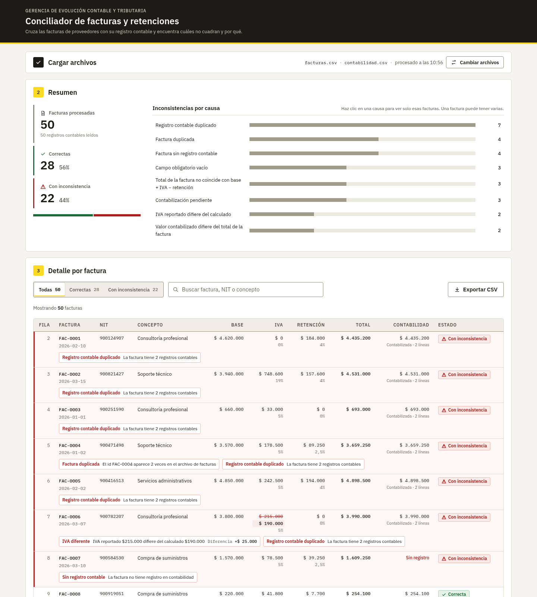

# Conciliador de facturas y retenciones

Solución a la prueba técnica para el rol de **Analista III** (Gerencia de Evolución Contable y Tributaria, Bancolombia).
Prototipo web que carga `facturas.csv` y `contabilidad.csv`, aplica reglas contables y tributarias y clasifica cada factura como **Correcta** o **Con inconsistencia**, indicando la causa.

> 📘 La explicación completa (instalación paso a paso, reglas con fórmulas, análisis factura por factura de los datos de prueba, API, rendimiento y solución de problemas) está en [`docs/GUIA_DETALLADA.md`](docs/GUIA_DETALLADA.md).



## 🚀 Funcionalidades

- **Carga de archivos** con validación: extensión, archivo vacío, columnas obligatorias y tamaño máximo de 2 MB.
- **Resumen**: cuántas facturas requieren revisión, indicadores (correctas, con inconsistencia, monto sin contabilizar y diferencia neta contable), gráfico de dona con el estado de las facturas (correctas, con una o con varias inconsistencias), diferencias netas por concepto y desglose por causa. Al pulsar una causa, la tabla se filtra.
- **Detalle por factura** con filtro por estado y por tipo de error, buscador (por id, NIT o concepto) y paginación. Cuando un valor no cuadra, se muestra el **reportado frente al calculado**.
- **Exportar a CSV** las filas filtradas, en un formato que Excel en español abre bien.
- **Probar con archivos de ejemplo**: un botón que procesa los CSV de `test-data/` sin tener que buscarlos en disco.
- **Estados de carga y error**: skeleton mientras se procesa y mensajes claros si un archivo es inválido (el archivo rechazado se marca con una ✕) o si el servidor no responde.
- **Tema claro, oscuro o del sistema**, con la elección recordada en el navegador.

## 🛠 Stack técnico

| | Versión probada | Mínima |
|---|---|---|
| Python | 3.10.12 | 3.10 |
| Node.js / npm | 20.20.0 / 10.8.2 | 20.19 |
| Angular CLI | 21.2.24 (se usa con `npx`; no hace falta instalarlo global) | — |

- **Backend**: FastAPI 0.115.12, Pydantic 2.14.1, Uvicorn 0.34.2 y python-multipart 0.0.20. Tests con pytest 8.3.5 y httpx 0.28.1. Las versiones están fijadas en `backend/requirements*.txt`.
- **Frontend**: Angular 21 standalone con signals, TypeScript 5.9 y SCSS propio, sin librería de UI. Tests con Vitest. Ver `frontend/package.json`.

## 📂 Arquitectura

```
Angular (:4200) ──multipart──▶ FastAPI (:8000) ──▶ lector CSV ──▶ reglas (funciones puras) ──▶ JSON {summary, results}
```

```
backend/app/
├── api/routes.py        GET /api/health · POST /api/reconciliations
├── domain/rules.py      reglas de negocio puras, sin I/O
├── services/            lectura de CSV y orquestación de la conciliación
└── schemas.py, errors.py   respuesta y formato de error {code, message, details}
frontend/src/app/
├── core/                modelos, servicio HTTP y store con signals
├── shared/ui/           atoms / molecules / organisms (Atomic Design, presentacionales)
└── pages/               página que conecta el store con los componentes
test-data/               CSV de ejemplo + errores/ para probar validaciones
docs/                    contrato API, presentación y declaración de uso de IA
```

### Decisiones técnicas

1. **Sin base de datos**: el enunciado no pide persistencia. Cada carga se procesa y se responde en una sola petición.
2. **`csv` de la stdlib y `Decimal` en lugar de pandas**: pandas convierte los montos a `float`. Así no se pierde precisión y el código se lee como las reglas contables.
3. **Capas `api → services → domain`**: las reglas son funciones puras probadas de forma aislada. No hay repositorios ni inyección de dependencias, porque el alcance no lo justifica.
4. **Contrato primero** ([`docs/api-contract.md`](docs/api-contract.md)): backend y frontend coinciden campo a campo. Swagger está disponible en `/docs`.
5. **Atomic Design con un único store de signals**: solo la página usa el estado; el resto de los componentes recibe `input()` y emite `output()`. No se usa NgRx.

## 🏁 Cómo ejecutar el proyecto

Se necesitan dos terminales y todos los comandos parten de la raíz del repositorio.

**1. Backend (puerto 8000)**

```bash
cd backend
python3 -m venv .venv
.venv/bin/pip install -r requirements-dev.txt
.venv/bin/uvicorn app.main:app --port 8000
```

En Windows (PowerShell), con `py -3 -m venv .venv` y `.venv\Scripts\pip …` / `.venv\Scripts\uvicorn …`.

Para comprobar que arrancó: `curl http://localhost:8000/api/health` debe devolver `{"status":"ok"}`. Swagger está en <http://localhost:8000/docs>.

> En Ubuntu/WSL, si `venv` falla con un error de `ensurepip`, instala `sudo apt install python3.10-venv python3-pip`.

**2. Frontend (puerto 4200)**

```bash
cd frontend
npm install
npx ng serve
```

Abrir <http://localhost:4200> o <http://127.0.0.1:4200>.

### Configuración (opcional)

El backend acepta estas variables de entorno: `CORS_ORIGINS` (por defecto `http://localhost:4200,http://127.0.0.1:4200`), `MAX_FILE_SIZE_BYTES` (2 MB) y `AMOUNT_TOLERANCE` (1 COP). El frontend apunta a `http://localhost:8000/api`; ese valor se cambia en `frontend/src/environments/environment.ts`.

Si la interfaz dice "No fue posible conectar con el servidor", el backend está apagado o el frontend se abrió desde un origen que no está en `CORS_ORIGINS`.

## 🧪 Cómo probar

1. Seleccionar `test-data/facturas.csv` y `test-data/contabilidad.csv` y pulsar **Procesar conciliación**, o usar el botón **Probar con archivos de ejemplo**.
2. **Resultado esperado: 50 facturas, 28 correctas y 22 con inconsistencia.**

| Causa | Facturas | Ejemplos |
|---|---|---|
| `REGISTRO_CONTABLE_DUPLICADO` | 7 | FAC-0001 a FAC-0006 |
| `FACTURA_DUPLICADA` | 4 | FAC-0004 ×2, FAC-0015 ×2 |
| `SIN_REGISTRO_CONTABLE` | 4 | FAC-0007, 0021, 0034, 0042 |
| `CAMPO_VACIO` | 3 | FAC-0013 (nit), 0029 (concepto), 0042 (fecha) |
| `TOTAL_DIFERENTE` | 3 | FAC-0009, 0023, 0036 |
| `CONTABILIZACION_PENDIENTE` | 3 | FAC-0011, 0027, 0039 |
| `IVA_DIFERENTE` | 2 | FAC-0006, 0018 |
| `VALOR_CONTABLE_DIFERENTE` | 2 | 2.ª ocurrencia de FAC-0004 y FAC-0015 |

La tabla cuenta facturas, no ocurrencias. Como una factura puede tener varias causas, la suma supera 22.

**Archivos de error** (`test-data/errores/`): al cargarlos como archivo de facturas, la interfaz muestra un mensaje claro.

| Archivo | Respuesta |
|---|---|
| `facturas_columnas_faltantes.csv` | 422 `MISSING_COLUMNS`, con la lista de las columnas que faltan |
| `vacio.csv` | 400 `INVALID_FILE` (archivo vacío) |
| `archivo.txt` | 400 `INVALID_FILE` (extensión distinta de .csv) |

**Tests automáticos**

```bash
cd backend && .venv/bin/pytest -q            # 64 tests: reglas, lector CSV y API (test golden 50/28/22)
cd frontend && npx ng test --watch=false     # 46 tests: servicio HTTP, store, filtros, paginación, resumen, tema y exportación
```

## 📐 Reglas de negocio y supuestos

Cada fila de facturas se evalúa por separado y acumula sus causas. Si no tiene ninguna es `Correcta`; si tiene al menos una, `Con inconsistencia`.

| Código | Regla |
|---|---|
| `IVA_DIFERENTE` | `valor_iva` ≠ `base_gravable × tarifa_iva` |
| `RETENCION_DIFERENTE` | `valor_retencion` ≠ `base_gravable × tarifa_retencion` |
| `TOTAL_DIFERENTE` | `total_factura` ≠ `base + IVA calculado − retención` |
| `FACTURA_DUPLICADA` | `id_factura` repetido en el archivo de facturas |
| `SIN_REGISTRO_CONTABLE` | el `id_factura` no existe en contabilidad |
| `REGISTRO_CONTABLE_DUPLICADO` | más de una línea contable para el mismo id |
| `CONTABILIZACION_PENDIENTE` | estado contable distinto de `Contabilizada` |
| `VALOR_CONTABLE_DIFERENTE` | la suma de débitos ≠ el total de la factura |
| `CAMPO_VACIO` / `VALOR_INVALIDO` | campo obligatorio vacío, o número o fecha no interpretable |

**Supuestos:**

- **Montos con `Decimal`**, redondeo a pesos `ROUND_HALF_UP` y tolerancia de ±1 COP. No se usa `float`, porque en cifras contables introduce errores de precisión.
- **El total se valida contra el IVA calculado.** Así se distingue un IVA mal reportado (FAC-0006, cuyo total sí cuadra) de un total mal calculado (FAC-0009).
- **En las facturas duplicadas se marcan todas las ocurrencias**, porque no hay criterio para saber cuál es la válida.
- **Un registro contable duplicado o pendiente es inconsistencia.** Es la opción conservadora: requiere revisión.
- **Un error de archivo rechaza la carga** (400/413/422), mientras que **un error de fila solo marca esa factura**.
- Los CSV de ejemplo traen BOM UTF-8, así que se leen con `utf-8-sig`.

## ⚠️ Limitaciones y pendientes

- No hay persistencia ni histórico (al recargar se pierde la conciliación) ni autenticación.
- **No se detectan duplicados por contenido**: FAC-0007 tiene los mismos valores que FAC-0045, pero con otro NIT.
- El cruce contable es solo por `id_factura`: no se validan la cuenta, el centro de costo, el crédito ni las fechas.
- Formato de entrada fijo: coma como separador, punto decimal y fechas `yyyy-mm-dd`.
- Volumen: hasta unas 20.000 facturas por archivo (2 MB), que se procesan en ~1,4 s. Para más filas habría que paginar en el servidor.
- No hay tests E2E automatizados (el flujo se validó a mano), ni `docker-compose` ni CI.

## 🤖 Uso de inteligencia artificial

Se usó IA generativa (Claude Code). El detalle de qué se generó, con qué propósito y qué revisó o decidió el candidato está en [`docs/DECLARACION_USO_IA.md`](docs/DECLARACION_USO_IA.md).

---
Desarrollado por Pavel Zambrano Gómez
